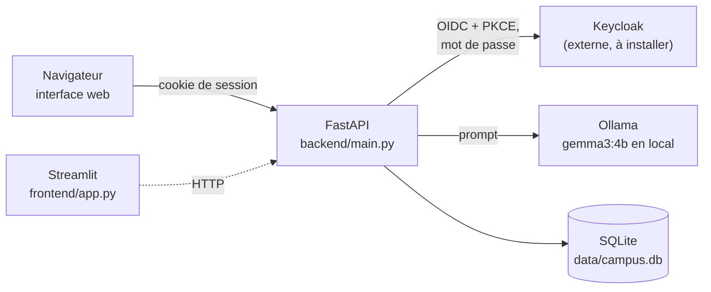

# Campus AI Assistant — ELMA

> **In English.** ELMA (Edge Learning & Mentoring Assistant) is a local, privacy-first study
> assistant for university students: Q&A, course summaries, revision planning and a well-being
> check, generated by a Gemma model running on the machine through Ollama. A FastAPI backend adds
> Keycloak sign-in (OIDC with PKCE), roles, rate limiting, prompt-injection filtering and
> pseudonymised usage logs. The documentation is in French.

## Problème

Un assistant IA pour étudiants manipule des données sensibles : questions, difficultés, état de
stress. Les envoyer à un service cloud pose des questions de confidentialité et de conformité au
RGPD. ELMA explore l'option inverse : **le modèle tourne en local**, l'accès passe par
l'authentification de l'établissement, et seules des métadonnées pseudonymisées sont conservées.

## Fonctionnalités

| Mode | Description |
|---|---|
| **Q&A** | Répond aux questions pédagogiques, à partir d'un contexte de cours fourni |
| **Résumé** | Résumé structuré d'un cours en 5 points clés |
| **Planning** | Planning de révision sur 7 jours |
| **Bien-être** | Estime le niveau de stress (réponse JSON) et propose un conseil |

- Interface web servie par FastAPI (thème clair / sombre), réponses en streaming (SSE).
- Connexion via Keycloak : redirection OIDC avec PKCE (S256), ou e-mail + mot de passe vérifiés
  par Keycloak, limités aux domaines autorisés.
- Interface Streamlit secondaire (`frontend/app.py`), voir [Limites](#limites).

## Architecture



| Fichier | Rôle |
|---|---|
| `backend/main.py` | Routes FastAPI, rate limiting, service de l'interface web |
| `backend/auth.py` | OIDC Keycloak, connexion par mot de passe, sessions, rôles |
| `backend/model.py` | Appel d'Ollama, détection du modèle disponible, mode dégradé |
| `backend/security.py` | Filtrage anti-injection, pseudonymisation |
| `backend/prompts.py` | Gabarits des quatre modes |
| `backend/database.py` | Schéma SQLite et accès aux données |
| `frontend/` | Interface web (HTML, CSS, JS) et interface Streamlit |
| `scripts/import_ensa_data.py` | Import du jeu de données de démonstration |
| `tests/test_api.py` | Script de mesure de latence (pas une suite pytest) |

Documentation complémentaire : [architecture](docs/architecture.md),
[configuration Keycloak](docs/keycloak_setup.md), [analyse des risques](docs/risques.md).

## Résultats

Le dépôt ne contient **aucune mesure** (latence, qualité des réponses). Les chiffres de
[`docs/architecture.md`](docs/architecture.md) sont des estimations.

### Ce qui a été vérifié

Vérifié le 17 novembre 2026 sous Windows, Python 3.11, dans un environnement virtuel neuf, avec le
`.env` issu de `.env.example` et **sans serveur Keycloak** :

- **Vérifié** : `pip install -r requirements.txt` aboutit ; l'import du jeu de démonstration charge
  9 utilisateurs, 9 questions, 5 consentements et 5 demandes RGPD ; le serveur FastAPI démarre ; la
  page web, `/docs` et `/health` répondent ; `/query`, `/stream` et `/stats` refusent l'accès sans
  session (401) ; l'interface Streamlit démarre. Avec Ollama et `gemma3:4b`, le code du modèle
  (`model.query_edge`, appelé directement) produit des réponses Q&A, un JSON valide pour le mode
  bien-être et un flux en streaming.
- **Non vérifié** : la connexion Keycloak (aucun serveur Keycloak lors du test) et donc une réponse
  du modèle **à travers l'API**, qui exige une session ; le script `tests/test_api.py` de bout en
  bout.

## Sécurité

- **Authentification Keycloak** : OIDC (code d'autorisation + PKCE S256) ou mot de passe vérifié par
  Keycloak ; e-mail limité aux domaines de `AUTH_ALLOWED_EMAIL_DOMAINS`, e-mail vérifié exigé par
  défaut. Les sessions sont stockées en SQLite (cookie `elma_session`, 12 h, rafraîchissement
  automatique des jetons).
- **Rôles** : tout utilisateur authentifié accède à l'IA ; le rôle `elma-admin` donne accès aux
  statistiques (`/stats`). Le rôle `elma-dpo` est reconnu dans la session mais n'ouvre encore aucune
  fonction dédiée.
- **IA locale** : le modèle tourne sur la machine via Ollama ; le contenu des questions n'est pas
  envoyé à un service externe.
- **Données et RGPD** : seules des métadonnées sont journalisées (tâche, latence, mode, horodatage)
  avec un identifiant pseudonymisé (SHA-256 tronqué à 16 caractères). Le schéma SQLite prévoit des
  tables pour les consentements, les demandes RGPD (accès, rectification, suppression, opposition)
  et un journal d'audit ; **aucune route ni interface ne les exploite encore**.
- **Entrées** : filtrage de 17 motifs d'injection de prompt après normalisation Unicode (NFKC),
  entrées tronquées à 2 000 caractères ; rate limiting de 30 requêtes par minute et par IP sur
  `/query` et `/stream` ; CORS limité aux origines locales.

Signaler une faille : [SECURITY.md](SECURITY.md).

## Installation

Prérequis : Python 3.11+, [Ollama](https://ollama.com), et un serveur Keycloak pour utiliser l'IA
(voir [`docs/keycloak_setup.md`](docs/keycloak_setup.md)).

```bash
git clone https://github.com/othmane1244/campus-ai-assistant.git
cd campus-ai-assistant

python -m venv venv
venv\Scripts\activate          # Windows
# source venv/bin/activate     # Linux / macOS

pip install -r requirements.txt
cp .env.example .env           # puis remplacer les valeurs (APP_SESSION_SECRET, Keycloak…)
ollama pull gemma3:4b

python scripts/import_ensa_data.py   # optionnel : données de démonstration fictives

cd backend
uvicorn main:app --host 127.0.0.1 --port 8000
```

Application : http://localhost:8000 · documentation de l'API : http://localhost:8000/docs.
Sous Windows, `run_elma.ps1` lance le serveur (il écoute sur `0.0.0.0`, donc sur le réseau local).

**Keycloak est requis pour l'IA** : sans configuration Keycloak, `/query` et `/stream` répondent
503 ; avec Keycloak configuré mais sans session, ils répondent 401. Seuls la page d'accueil, `/health`
et `/docs` fonctionnent sans Keycloak.

### Données de démonstration

`data/seed_demo.sql` est **entièrement fictif** : 9 comptes en `@example.com` (rôles admin, DPO,
étudiants), des questions, des consentements et des demandes RGPD inventés. Les empreintes bcrypt
des comptes correspondent au mot de passe de démonstration **`ElmaDemo-2026!`**. La connexion passant
par Keycloak, ces empreintes ne servent pas à se connecter : pour tester, créer les mêmes comptes dans
Keycloak.

### Configuration

Les variables sont décrites dans [`.env.example`](.env.example) (valeurs factices). Les principales :
`APP_SESSION_SECRET`, `CAMPUS_MODEL`, `KEYCLOAK_SERVER_URL`, `KEYCLOAK_REALM` (`ensa`),
`KEYCLOAK_CLIENT_ID` (`elma-web`), `KEYCLOAK_ADMIN_ROLE`, `KEYCLOAK_DPO_ROLE`,
`AUTH_ALLOWED_EMAIL_DOMAINS`, `AUTH_REQUIRE_VERIFIED_EMAIL`.

### Mesure de latence

```bash
python tests/test_api.py
```

Le script interroge le serveur sur le port 8000. Il ne gère pas l'authentification : avec Keycloak
actif, il s'arrête en expliquant que `/query` exige une session.

## Endpoints

| Endpoint | Auth | Description |
|---|---|---|
| `GET /` | — | Interface web |
| `GET /health` | — | État d'Ollama et de l'authentification |
| `POST /query` | utilisateur | Requête IA (réponse complète) |
| `POST /stream` | utilisateur | Requête IA (streaming SSE) |
| `GET /stats` | `elma-admin` | Statistiques d'usage |
| `GET /auth/me` | — | État de la session |
| `POST /auth/login/password` | — | Connexion e-mail + mot de passe (via Keycloak) |
| `GET /auth/login`, `/auth/callback`, `/auth/logout` | — | Connexion OIDC et déconnexion |
| `GET /docs` | — | Documentation Swagger |

## Limites

- **Keycloak obligatoire** pour toute fonction d'IA ; aucun mode sans authentification.
- **Interface Streamlit** : elle démarre mais n'envoie pas de session ; ses requêtes à `/query` sont
  donc refusées (401) dès que Keycloak est configuré.
- **Keycloak injoignable** : `POST /auth/login/password` renvoie une erreur 500 au lieu d'un message
  explicite.
- **RGPD** : consentements, demandes RGPD et journal d'audit n'existent que dans le schéma ; la table
  `users` (et la colonne `password_hash`) n'est pas utilisée par l'application.
- **Aucune mesure** de latence ni de qualité des réponses dans le dépôt.
- **Filtre anti-injection par liste de motifs** : contournable par reformulation.
- **Synchronisation cloud** (`backend/sync.py`) : simple ébauche, non implémentée.

## Contexte

Projet du module « Éthique et droit numérique », cycle ingénieur IA & Cybersécurité (ENSA Béni
Mellal).

Auteur : Othmane Aliouali.

## Licence

MIT, voir [LICENSE](LICENSE).
